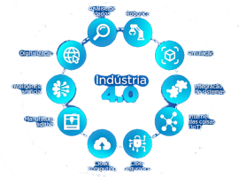

# Indústria 4.0

Este repositório tem como objetivo demonstrar meus conhecimento e experiência na área de TI aplicados na indústria. Para
tanto, irei criar demos/POCs de código e ferramentas.

\
**SENAI Explorando a Indústria 4.0**

[![Licença][shieldLicense]](LICENSE.txt)

## Índice

1. [Introdução](#introdução)
   1. [IA Local](IA%20Local/README.md)
   2. [Manufatura Aditiva](Manufatura%20Aditiva/README.md)
   3. [Realidade Aumentada](Realidade%20Aumentada/README.md)
2. [Agradecimentos e Contato](#agradecimentos-e-contato)
3. [Licença](#licença)

## Introdução

A quarta revolução industrial tem como foco a **Integração** e a **Conectividade**; em transformar os dados existentes
em conhecimento para o gestor. A **Indústria 4.0** vai além do processo de fabricação, abrangendo o planejamento, a
logística da cadeia de fornecimento e desenvolvimento de produtos através do uso de diferentes áreas do conhecimento no
processo fabril, desde projeto auxiliado por computador, passando pela impressão 3D, até a integração de profissionais
de TI e o uso de computação em nuvem.

Com a **Indústria 4.0** deseja-se construir um ambiente em que as máquinas e os equipamentos podem melhorar os processos
por meio de automação e auto-otimização.

A **Indústria 4.0** cria fábricas inteligentes, conectadas e altamente automatizadas. Seus pilares são:

|                                                     | Descrição                                                                                                                                      |
| --------------------------------------------------- | ---------------------------------------------------------------------------------------------------------------------------------------------- |
| **Big Data e Análise de Dados**                     | Utiliza grandes volumes de dados para identificar padrões, otimizar operações e prever falhas.                                                 |
| **Inteligência Artificial (IA) e Machine Learning** | Automatiza processos e otimiza a produção ao aprender com dados históricos.                                                                    |
| **Internet das Coisas (IoT)**                       | Conecta dispositivos e sensores para coletar e analisar dados em tempo real, permite monitoramento e controle remoto dos processos produtivos. |
| **Manufatura Aditiva (Impressão 3D)**               | Permite a produção de peças e componentes diretamente a partir de modelos digitais.                                                            |
| **Realidade Aumentada e Virtual**                   | Melhora o treinamento, o suporte técnico e a visualização de processos por meio de interfaces imersivas e interativas.                         |
| **Robótica Avançada**                               | Implementa robôs colaborativos e autônomos que realizam tarefas complexas com precisão e eficiência.                                           |
| **Simulação e Digital Twins**                       | Cria modelos virtuais de processos e produtos para simulação e testes.                                                                         |

(<a href="#header">voltar ao topo</a>)

## Agradecimentos e Contato

Nós temos orgulho de ser _Powered by Open Source Community_:

- Fale conosco [via Discussion](https://github.com/portfolio-2026br/industria-4.0/discussions):\
  

(<a href="#header">voltar ao topo</a>)

## Licença

GNU General Public License v2.0.

(<a href="#header">voltar ao topo</a>)

<!-- markdownlint-enable MD033 -->

[shieldLicense]: https://img.shields.io/badge/License-GPL%20v2-blue.svg?label=Licen%C3%A7a
